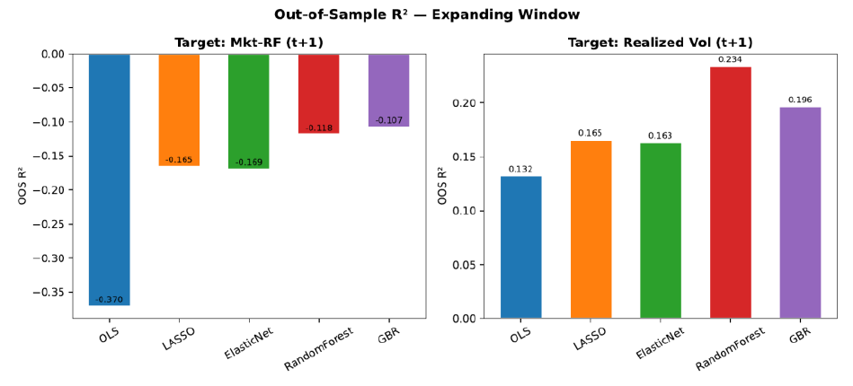
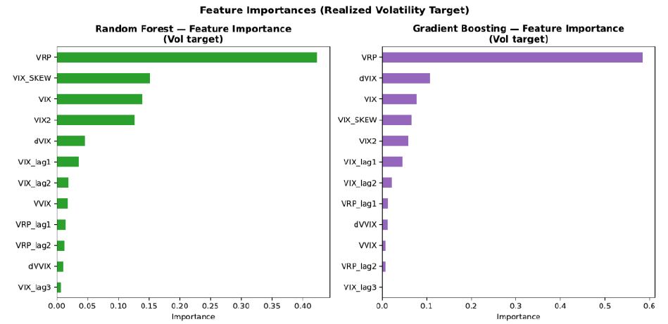

# Forecasting Volatility from Option-Implied Measures with Machine Learning

Can the options market's fear gauges (VIX, VVIX and the volatility risk premium) forecast next month's equity **returns** or **realized volatility**? Can tree-based models extract more than a linear regression?

*Final project for Machine Learning in Finance (BUSN 35137), University of Chicago Booth School of Business (Mar 2026).*

<p align="center">
  
</p>

## Findings

| Model | OOS R², next-month excess return | OOS R², next-month realized vol |
|---|---:|---:|
| OLS | −0.370 | 0.132 |
| LASSO | −0.165 | 0.166 |
| Elastic Net | −0.169 | 0.163 |
| **Random Forest** | −0.118 | **0.234** |
| Gradient Boosting | −0.107 | 0.196 |

- **Returns:** no model beats the historical mean (every OOS R² is below zero), which is consistent with Goyal & Welch (2008).
- **Volatility:** every model has positive predictive power. Random Forest raises OOS R² from 0.13 (OLS) to 0.23, which suggests a nonlinear relationship between implied and realized volatility.
- **The VRP drives the forecast.** The volatility risk premium (VIX − realized vol) is the dominant feature in both tree models. When options are rich relative to recent realized volatility, future volatility tends to stay elevated.
- **The gain is economically meaningful but not statistically conclusive.** A Diebold–Mariano test of Random Forest against OLS squared errors on the volatility target gives p ≈ 0.36. With 94 out-of-sample months, the gain over OLS is not significant at conventional levels.

<p align="center">
  
</p>

## Method

- **Sample:** monthly data from Feb 2007 to Nov 2024 (214 months). The start date is set by when VVIX data begins.
- **Features (14):** VIX, VIX², VVIX, VRP, monthly changes, lags 1–3 and interaction terms.
- **Targets:** Mkt−RF at t+1 and S&P 500 21-day realized volatility at t+1.
- **Models:** OLS, LASSO and Elastic Net (CV-tuned), Random Forest (300 trees, depth 4) and Gradient Boosting (early stopping).
- **Evaluation:** expanding-window walk-forward with a 120-month initial training window. Each forecast uses only data available at the time. OOS R² is measured against the historical mean, following Goyal & Welch (2008).
- **Interpretation:** feature importance, SHAP values, partial dependence and regime splits (NBER recession vs. expansion).

## Repository layout

```
├── src/vol_research.py        # data download → features → walk-forward OOS → SHAP/PDP → PDF report
├── src/make_writeup.py        # typesets the paper-style write-up from the cached data
├── paper/ML_Implied_Volatility_Paper.pdf
├── figures/
└── requirements.txt
```

## Reproducing

```bash
pip install -r requirements.txt
python src/vol_research.py      # downloads public data on first run, caches to src/vol_data_cache.pkl
```

All inputs are free and public: FRED (VIX, VIX3M, NBER recession flag), Yahoo Finance (^GSPC, ^VVIX) and the Ken French Data Library. A rerun on the cached data reproduces the table above to the third decimal (Random Forest vol R² 0.233).

## Limitations

- **CBOE SKEW was unavailable from FRED when the data was pulled,** so the SKEW-based features carry no information.
- **The sample is short.** 94 out-of-sample months is too few for strong statistical claims, as the DM test shows.
- **Feature importance comes from a full-sample fit,** used for interpretation only. All forecasting results are out-of-sample.

## Tools

Python · scikit-learn · SHAP · pandas · NumPy · SciPy · yfinance · pandas-datareader · matplotlib · seaborn
